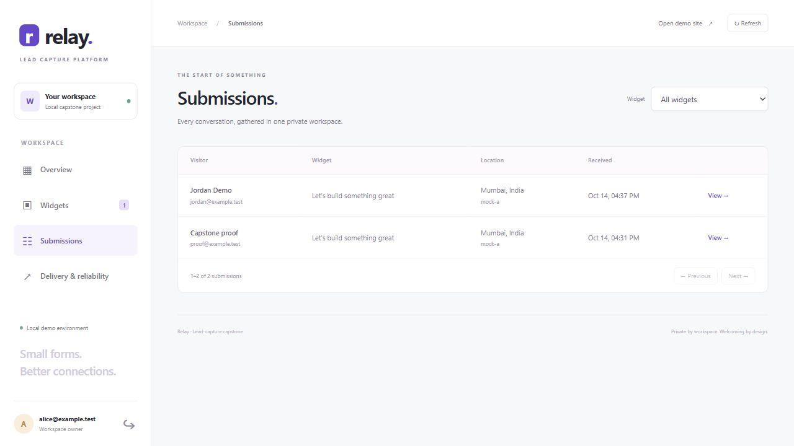
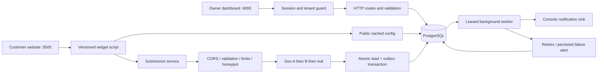
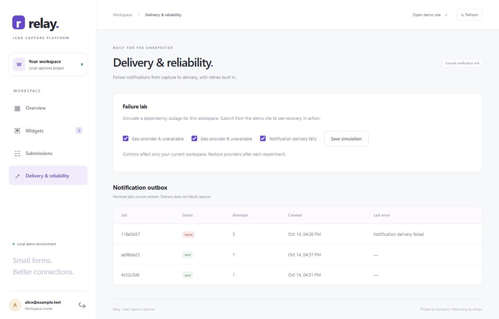

# Relay — Lead-Capture Widget Platform

Create a form, embed one script on a customer website, and manage captured leads in a private workspace. This FlyRank capstone includes tenant isolation, resilient geolocation, spam and rate controls, idempotent submissions, a durable notification worker, and an owner dashboard. Built with **Node.js, Express, PostgreSQL, and plain browser JavaScript**.

[Design](DESIGN.md) · [Acceptance evidence](EVIDENCE.md) · [Build log](BUILDLOG.md) · [Run manifest](capstone.yaml)



## Start locally

Requirements: Git, Node.js **22+** (24 recommended), Docker Desktop with its Linux engine running, and available ports **4000**, **5500**, and **5433**. No paid accounts or API keys are required.

```sh
git clone https://github.com/rishit-kadha/flyrank-capstone-widget-platform.git
cd flyrank-capstone-widget-platform
npm run init
docker compose up --build -d --wait
docker compose exec api npm run seed
```

`npm run init` uses only Node built-ins and generates an ignored `.env` with random local database and demo passwords; it preserves an existing file. Dependencies are installed inside Docker. Initial image downloads depend on your connection.

Open the **[owner dashboard](http://localhost:4000)** and **[customer demo](http://localhost:5500)**. Sign in as `alice@example.test` or `bob@example.test` using the `DEMO_PASSWORD` from your local `.env`. Each owner has a separate workspace. Use fictional contact information in this demo.

The API applies migrations automatically. Seed is repeatable: it creates the demo tenants and refreshes their passwords and sample widget configurations; existing submissions remain. Alice's sample widget is `11111111-1111-4111-8111-111111111111`; Bob's is `22222222-2222-4222-8222-222222222222`.

```sh
docker compose ps                       # Inspect services
docker compose logs -f worker           # Notification outcomes, without lead fields
docker compose exec api npm test        # PostgreSQL acceptance suite
docker compose down                    # Stop; retain the database volume
```

If Docker reports an engine error, restart Docker Desktop, wait for it to start, then run `docker compose up -d --wait`. Do not remove the database volume to fix an engine problem. Data persists in the `widget_pgdata` named volume.

### Develop with Node directly

```sh
npm ci
npm run init
docker compose up -d db
npm run migrate
npm run seed
npm start
```

Run `npm run worker` and `npm run customer` in separate terminals. Stop the Compose API/customer first if they occupy ports 4000/5500. The generated host `DATABASE_URL` uses localhost:5433; Compose overrides it with the internal database address.

## Use the platform

1. Sign in, select **Widgets**, and create or edit a form. Contact, signup and popover widgets support up to eight text, email or textarea fields.
2. Select **Embed** and copy the script into the customer's HTML. The demo page already embeds Alice's sample widget.
3. Submit on port 5500. Refresh the dashboard on port 4000 to see saved fields, approximate location, daily activity and per-widget totals.
4. Open **Delivery & reliability** to inspect jobs and simulate dependency failures.

```html
<script src="http://localhost:4000/widget.v1.js?id=11111111-1111-4111-8111-111111111111" defer></script>
```

The widget uses Shadow DOM, renders configured text safely, and sends public requests without owner credentials. Its API origin comes from the script URL. Preview another widget at `http://localhost:5500/?widget=YOUR_WIDGET_UUID`.

<details>
<summary>Customer website and successful embedded submission</summary>


</details>

## Architecture



| Layer | Location | Responsibility |
| --- | --- | --- |
| HTTP | `src/app.js`, `validation.js`, `errors.js` | Authentication, CORS, strict schemas, caching and JSON errors |
| Services | `src/services.js`, `geo.js`, `jobs.js` | Capture orchestration, provider fallback and notification outcomes |
| Data | `src/repository.js`, `db.js`, `migrations/` | Parameterized tenant-scoped queries, indexes, constraints and transactions |
| Worker | `src/worker.js` | SKIP LOCKED claims, lease recovery, retries and failure alerts |
| Browser | `public/`, `customer/` | Owner interface, versioned embed and separate-origin demo |

The tenant ID comes from the verified session. Composite foreign keys also prevent cross-tenant widget/submission relationships. Passwords use salted scrypt; opaque bearer sessions are stored as hashes and expire after eight hours. Logout invalidates them immediately.

The unique `(widget_id, idempotency_key)` constraint deduplicates concurrent retries. A canonical request hash rejects key reuse with different content. A lead and notification job commit together; delivery happens outside the request. Leases recover after worker interruption, and stale workers cannot overwrite a newer attempt.

## API reference

Base URL: `http://localhost:4000`. Owner routes require `Authorization: Bearer <access_token>`. Bodies use `Content-Type: application/json` and have a **16 KiB** cap. Errors use `{ "error": { "code": "…", "message": "…", "details": [] } }`; details is optional.

| Method | Endpoint | Owner auth | Success |
| --- | --- | --- | --- |
| GET | `/health` | No | 200 database health |
| POST | `/api/auth/login` | No | 200 `{access_token,user}` for `{email,password}` |
| POST | `/api/auth/logout` | Yes | 204 |
| GET | `/api/auth/me` | Yes | 200 `{user}` |
| GET / POST | `/api/widgets` | Yes | 200 `{items}` / 201 widget |
| GET / PATCH / DELETE | `/api/widgets/:id` | Yes | 200 widget / 200 updated / 204 |
| GET | `/api/widgets/:id/embed` | Yes | 200 `{snippet,script_url}` |
| GET | `/widgets/:id/config` | No | 200 config; 60-second cache, ETag/304 |
| GET | `/widget.v1.js?id=:id` | No | 200 JS; one-year immutable cache |
| GET | `/widget.js?id=:id` | No | 302 to versioned script; no-cache |
| OPTIONS | `/submissions` | No | 204 CORS preflight |
| POST | `/submissions` | No | 201 `{id,replayed:false,geo}`; replay 200 |
| GET | `/api/submissions?widget_id=UUID&limit=20&offset=0` | Yes | 200 `{items,total}`; filter optional |
| GET | `/api/submissions/:id` | Yes | 200 submission |
| GET | `/api/dashboard` | Yes | 200 total, by_day, by_widget, by_country, jobs |
| GET | `/api/jobs` | Yes | 200 `{items}` with attempts and failure alerts |
| GET / PUT | `/api/demo/failures` | Yes | 200 workspace simulation flags |

Create-widget JSON (`title` and `fields` required; the other shown fields have defaults):

```json
{
  "type": "contact",
  "title": "Let's talk",
  "description": "Tell us about your idea.",
  "button_text": "Send message",
  "fields": [
    {"name":"name","label":"Your name","type":"text","required":false},
    {"name":"email","label":"Email address","type":"email","required":true}
  ],
  "display": {"accent":"#2563eb","position":"inline"},
  "active": true
}
```

PATCH accepts partial changes. Field names must be unique lowercase identifiers; reserved and unknown fields are rejected. Submission fields must match the current widget schema. Text/email fields allow 254 characters, textarea allows 4,000. Pagination limit is 1–100. Widget deletion is soft and retains historical leads.

Public submission example (POSIX shell; on PowerShell use `curl.exe` and put JSON in a file if needed):

```sh
curl -i http://localhost:4000/submissions \
  -H 'Origin: http://localhost:5500' \
  -H 'Content-Type: application/json' \
  -H 'Idempotency-Key: example-request-001' \
  --data '{"widget_id":"11111111-1111-4111-8111-111111111111","fields":{"name":"Demo Visitor","email":"visitor@example.test","message":"Hello!"},"website":""}'
```

Keep the same key for retries of one logical submission; use a new key for new submissions (8–100 letters, digits, hyphens or underscores). Changed content with the same key returns **409**. The hidden `website` honeypot must be empty.

Common errors: **400** validation/spam, **401** owner session, **404** missing/inactive public widget or non-owned resource, **413** body cap, **415** content type/encoding, **429** rate limit with `Retry-After`. Default limits are 10 submissions per IP and 100 per widget per 60 seconds, stored atomically in PostgreSQL. Login allows 20 requests per IP/window.

## Configuration and failure demonstrations

See [.env.example](.env.example). Never commit `.env`, tokens, passwords or real lead exports.

| Setting | Default | Meaning |
| --- | --- | --- |
| `DATABASE_URL` / `POSTGRES_*` | Generated | Local database access; Compose overrides hostname |
| `DEMO_PASSWORD` | Random | Demo-owner password used by seed |
| `PUBLIC_BASE_URL` | `http://localhost:4000` | Origin used in embed snippets |
| `PORT` / `CUSTOMER_PORT` | 4000 / 5500 | Servers; update Compose mappings if changing ports |
| `GEO_MODE` | `mock` | `mock`, `live`, or `off` |
| `DEMO_CONTROLS` | `true` | False disables simulation endpoints |
| `NOTIFICATION_MODE` | `console` | Local sink; `fail` forces failure |
| `IP_RATE_LIMIT` / `WIDGET_RATE_LIMIT` | 10 / 100 | Submission limits per window |
| `RATE_WINDOW_SECONDS` | 60 | Limit window |
| `TRUST_PROXY_HOPS` | 0 | Ignore forwarded IP headers by default |
| `JOB_MAX_ATTEMPTS` / `JOB_RETRY_MS` / `JOB_POLL_MS` | 3 / 2000 / 500 | Attempts, exponential retry base and polling |

Mock geo returns labeled simulated locations: A gives Mumbai/India, B gives London/United Kingdom, both unavailable gives null. Live mode tries HTTPS `ipapi.co`, then `ipwho.is`, with a 1.5-second timeout per provider. Failure still stores the lead with null geo. Live mode skips private/loopback IPs, so localhost normally has no geo. It sends the public visitor IP to those providers; the database stores only an IP hash. `off` makes no provider calls.

Use **Delivery & reliability → Failure lab** to demonstrate resilience:

1. Disable provider A; submit a fictional lead and observe `mock-b`.
2. Disable both geo providers; submit and observe a saved lead with unknown location.
3. Enable notification failure; submit, wait about seven seconds, then refresh the outbox. The lead saves immediately. After three failures the job is terminal and a persistent alert is available in the jobs API and worker log.
4. Restore all switches. They affect only the current workspace. Failed jobs remain as history; there is no automatic replay after terminal failure.



## Tests and evidence

**30 passing tests** cover 25 real-PostgreSQL integration cases and five deterministic geo cases. Each run creates a random validated `test_<hex>` schema, applies migrations, seeds unrelated tenants, and drops only that schema. Existing app data is untouched. Set `TEST_DATABASE_URL` to override the normal connection; the role needs permission to create schemas.

Coverage includes tenant boundaries, session expiry/logout, strict errors, CORS/cache, throttling/proxy spoofing, spam, provider fallback, idempotency races, transaction rollback, bounded retries, alerts, lease recovery and aggregation. GitHub Actions runs the same suite against a disposable database. [EVIDENCE.md](EVIDENCE.md) includes recorded output, browser checks and persisted results after a Docker restart.

## Limitations

- Local capstone only: accounts are seeded. Registration, password reset, TLS termination and production operations are outside scope.
- Notifications use a **console sink**, not real email. Real providers should use provider-side idempotency keys: effects are at least once if a worker crashes after delivery but before acknowledgement.
- Public widget IDs are public by design. CORS is not authorization. Add stronger abuse protection before a real public deployment.
- Tenant isolation uses application predicates and database relationships, not PostgreSQL RLS. Set trusted proxy hops only for a known deployment path.
- Geo is approximate, nullable and mocked by default. Provider availability/limits can change. There is no geo cache or production data-retention policy.
- Immutable script changes need a new filename/version. Config changes may take 60 seconds to appear. Dashboard activity is UTC; the chart shows seven days.
- No runtime AI is used: no model calls, tokens or API charges. Development assistance is documented honestly in BUILDLOG.md.

## License

[MIT](LICENSE)
